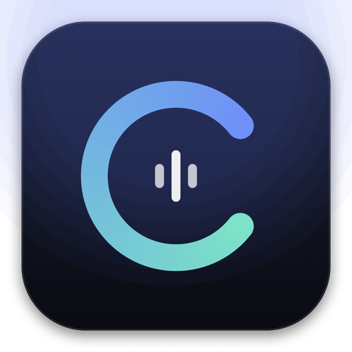
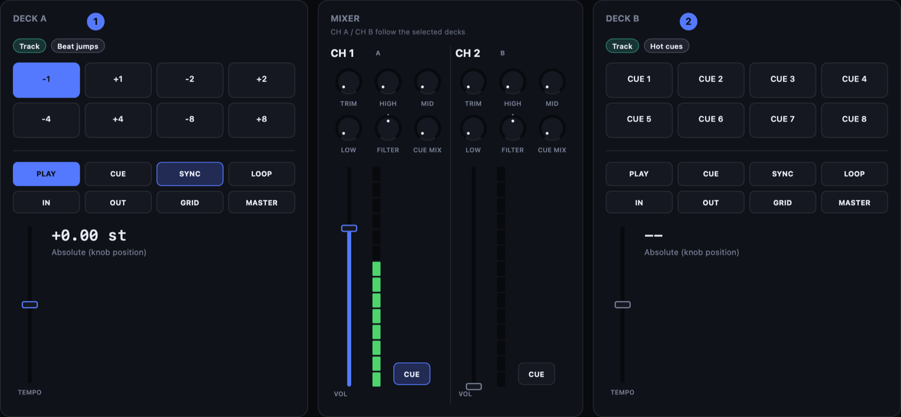
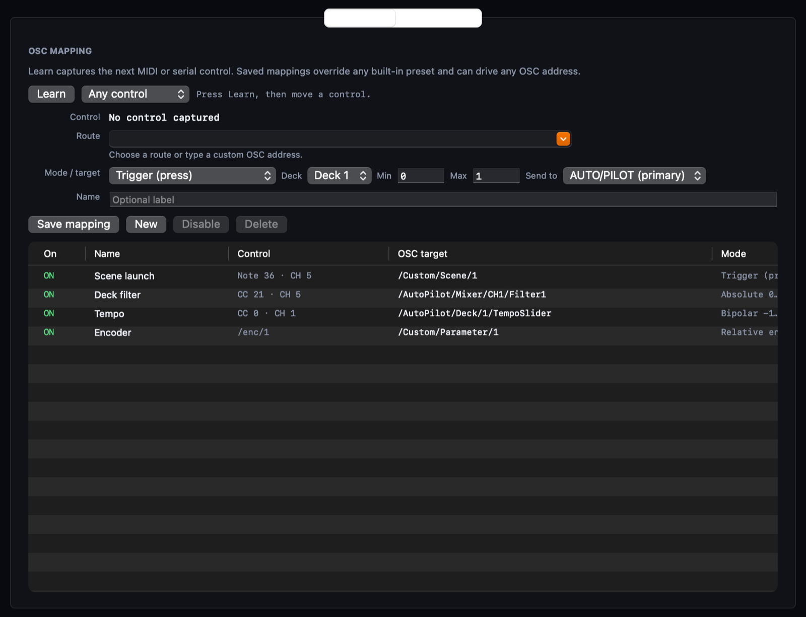
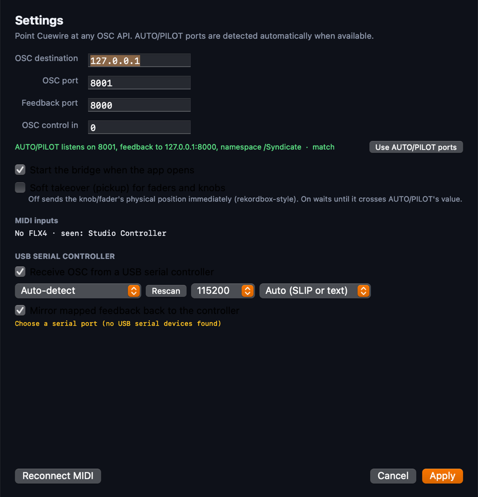

<p align="center">
  
</p>

<h1 align="center">Cuewire</h1>

<p align="center">
  <strong>A controller-to-OSC router for macOS.</strong><br>
  Map any MIDI control, serial OSC message or UDP OSC input to any OSC API — one API or several at once.
</p>

<p align="center">
  
  
  
  
</p>



Cuewire sits between your hardware and the software that speaks OSC. It opens
every MIDI source, receives OSC over UDP and USB serial, learns controls, and
routes each one to the OSC address you choose — including several destinations
in the same session.

DDJ-FLX4 and AUTO/PILOT are the first supported presets, not the boundary of the
product. The surface above is the live FLX4 view; the same engine maps a custom
pad grid, a fader bank, an ESP32 encoder or a DAW scene launcher just as well.

## What it does

- **Any OSC API, not one vendor.** Point Cuewire at any host and port, then map
  controls to any address. The route picker is pre-filled from AUTO/PILOT when it
  is running, but custom addresses are first-class.
- **Multi-device routing.** Add extra OSC destinations with an owned address
  prefix. The longest matching prefix wins, so a single controller can drive
  AUTO/PILOT, Resolume, a visualizer and a lighting rig at the same time.
- **Any controller.** Every MIDI source is opened. MIDI Learn captures notes and
  CCs from whichever device you touch; 14-bit pairs, relative encoders and
  momentary/toggle behaviour are handled for you.
- **Serial and UDP OSC inputs.** An ESP32-S3 or any OSC-speaking controller can
  feed the same mapping engine over USB serial (SLIP or newline framing) or UDP.
- **Feedback-aware.** Buttons, LEDs, toggles and soft-takeover pickup use the
  destination's own feedback instead of guessing.
- **Presets where they help.** The FLX4 gets 14-bit faders, deck switching, shift
  layers and its centre-detent filter split. AUTO/PILOT ports and routes are
  discovered from the running app. Everything else stays generic.

## Install

Build from source (macOS 14+, Xcode command line tools):

```sh
git clone https://github.com/ethanbanker/cuewire.git
cd cuewire
./scripts/build-app.sh
open "dist/Cuewire.app"
```

The app starts routing automatically, puts a waveform icon in the menu bar, and
hides to the menu bar when its window closes.

## Routing model

```
MIDI controllers ─┐
Serial OSC       ─┼─▶ Cuewire engine ─▶ mappings ─▶ destination A (prefix /A)
UDP OSC          ─┘        ▲                        destination B (prefix /B)
                           └──── feedback from each destination
```

1. **Inputs** — all MIDI sources, a serial port, and an optional UDP control port.
2. **Mappings** — learned or hand-written: source control → OSC address, mode,
   range, deck substitution and target destination.
3. **Destinations** — the primary OSC API plus any extra host/port with an owned
   prefix. Unmatched traffic goes to the primary destination.

A mapping can target one specific destination, which is how a controller split
across applications stays predictable.

## Mapping editor



**Bridge → OSC Mapping…** (⌘L) captures a control with Learn, then maps it to any
OSC address.

- **Trigger** — send `1` on press.
- **Momentary** — send `1` while held, `0` on release.
- **Toggle** — flip from confirmed feedback.
- **Absolute 0…1** — faders and knobs; learned 14-bit controls keep their precision.
- **Bipolar −1…+1** — centred tempo/filter-style controls.
- **Relative encoder** — signed deltas.
- **Passthrough** — forward an OSC input message unchanged.

Picking a route applies its natural mode, and Save upgrades a leftover Trigger on
a continuous route, so a fader can never be saved as a one-shot press.

Mappings live in `~/Library/Application Support/Cuewire/mappings.json` and override
built-in presets by control identity. Pre-1.0 files in the old `FLX Bridge` folder
migrate automatically.



## Supported today

| Area | Status |
|---|---|
| MIDI controllers | Any CoreMIDI source; Learn works per note/CC, including 14-bit faders |
| DDJ-FLX4 | Full preset: deck controls, pads, loops, browse, mixer, 14-bit tempo/volume, centre-detent filter |
| AUTO/PILOT | Port and route discovery, feedback subscriptions, hub routing, `/Syndicate` ↔ `/AutoPilot` folding |
| Serial OSC | ESP32-S3 or any USB serial device; SLIP or newline framing, auto-detected |
| UDP OSC input | Optional control port with the same mapping engine |
| Extra destinations | Any IPv4 host/port with an address prefix; longest prefix wins |
| Feedback | Button LEDs, switch state, fader pickup, mapped feedback mirroring |

Generic controllers use **Learn**; the FLX4's stock bindings only run while an
FLX4 is actually connected, so another controller's notes and CCs are never
mapped by accident.

### FLX4 preset reference

| Control | MIDI | Default route |
|---|---|---|
| Play / Cue | CH 0/1 note 11 / 12 | `Deck/{deck}/PlayPause`, `Cue` |
| Sync / Master | CH 0/1 note 88 / 92 | `TempoSync`, `TempoMaster` |
| In / Out / 4-beat | CH 0/1 note 16 / 17 / 77 | `LoopIn`, `LoopOut`, `Loop` |
| Tempo fader | CH 0/1 CC 0 (14-bit) | `TempoSlider`, bipolar, + at bottom |
| Channel fader / trim | CH 0/1 CC 19 / 4 | `Mixer/CH{D}/Volume`, `Trim` |
| High / Mid / Low | CH 0/1 CC 7 / 11 / 15 | `Mixer/CH{D}/EQ/*` |
| Filter | CH 6 CC 23 / 24 | left half `Filter1`, right half `Filter2`, centre 0/0 |
| Master / headphone | CH 6 CC 8 / 13 / 12 | `Header/MasterVolume`, `CueVolume`, `CueMix` |
| Deck select | CH 6 note 104 / 122 | 1↔3, 2↔4 |
| Browse | CH 6 CC 64 | `Browser/Up`, `Browser/Down` |
| Load | CH 6 note 70 / 71 | `Browser/L{deck}` |

Faders and knobs are absolute by default, like rekordbox. **Settings → Soft
takeover** makes them wait for the destination's confirmed value instead.

## AUTO/PILOT setup

AUTO/PILOT is optional. When it is running, Cuewire reads its settings and fills
in the ports and route list automatically.

1. In AUTO/PILOT, disable the FLX4's direct MIDI input so actions are not applied twice.
2. Enable OSC input. Cuewire reads `osc.listenPort` and `osc.feedbackPort`, and
   warns when they disagree with its own settings. **Use AUTO/PILOT ports** re-syncs.
3. Keep OSC feedback enabled and subscribe to all routes, including TempoSlider.
   Without feedback, CUE, toggles and pickup stay blocked and the log says why.
4. Point other applications at Cuewire's extra destinations with their own prefixes.

AUTO/PILOT accepts commands under `/AutoPilot/…` and publishes feedback under
`/Syndicate/…` in current builds. Cuewire folds either namespace back to one key
space, and serial commands from either are normalised.

## Serial OSC controller

Cuewire opens a USB serial port and decodes OSC with SLIP framing or newline
text, auto-detected. Short addresses expand:

```text
/Deck/1/PlayPause         → /AutoPilot/Deck/1/PlayPause
/Mixer/CH1/Volume         → /AutoPilot/Mixer/CH1/Volume
/Syndicate/Deck/1/Playing → /AutoPilot/Deck/1/Playing
```

When a serial mapping exists, its feedback is mirrored back over the serial link
as `/AutoPilot/…` SLIP messages. Only mapped routes are mirrored, so the
controller does not receive every feedback path.

## Development

```sh
swift build
swift run BridgeChecks        # 234 checks
./scripts/build-app.sh        # dist/Cuewire.app
swift scripts/make-icon.swift /tmp/icon.png
```

`BridgeCore` is UI-free and covered by the `BridgeChecks` executable; the AppKit
app only observes `BridgeService` snapshots. Checks cover 14-bit precision and
direction, centre-detent filter splitting, generic-controller isolation from the
FLX4 preset, learned mapping modes, feedback validation, OSC serialization and
SLIP framing, hot-plug MIDI, hub routing, settings persistence and mode defaults.

## Limits

- Toggles and pickup require confirmed feedback from the destination.
- The FLX4 preset assumes AP's **LP/HP** filter type.
- Serial OSC uses one port at a time.
- The app is ad-hoc signed; Gatekeeper may ask for confirmation on first launch.
- Unofficial project. Not affiliated with AlphaTheta/Pioneer DJ or AUTO/PILOT.

## License

MIT — see [LICENSE](LICENSE).
